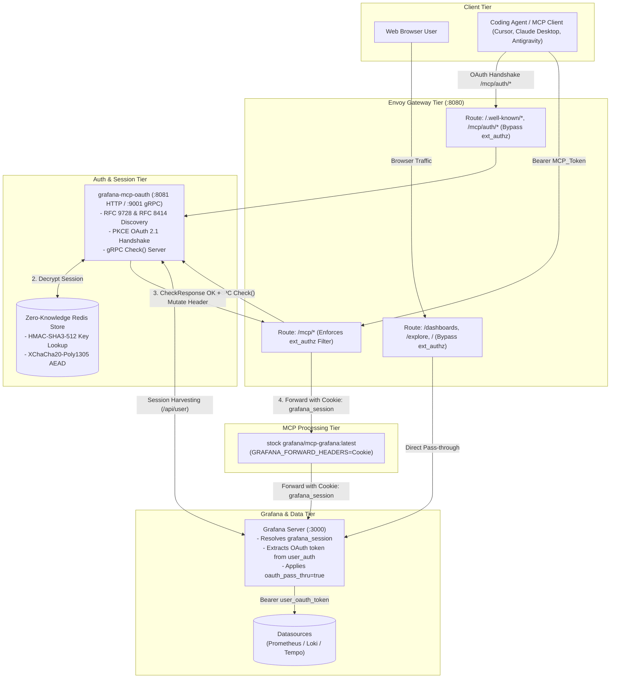
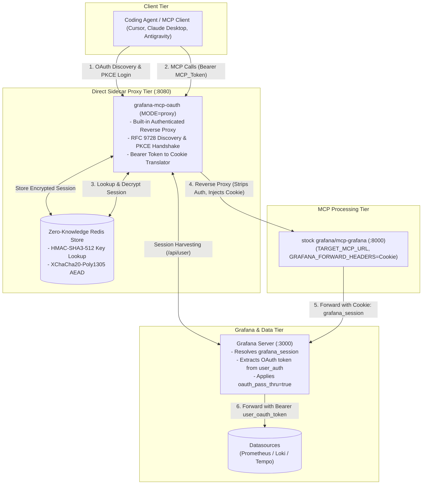
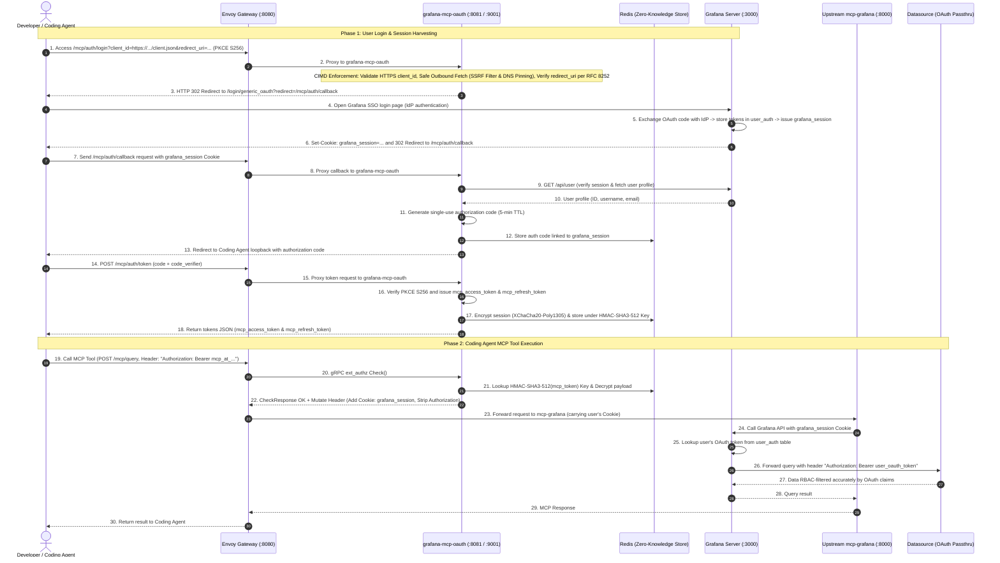
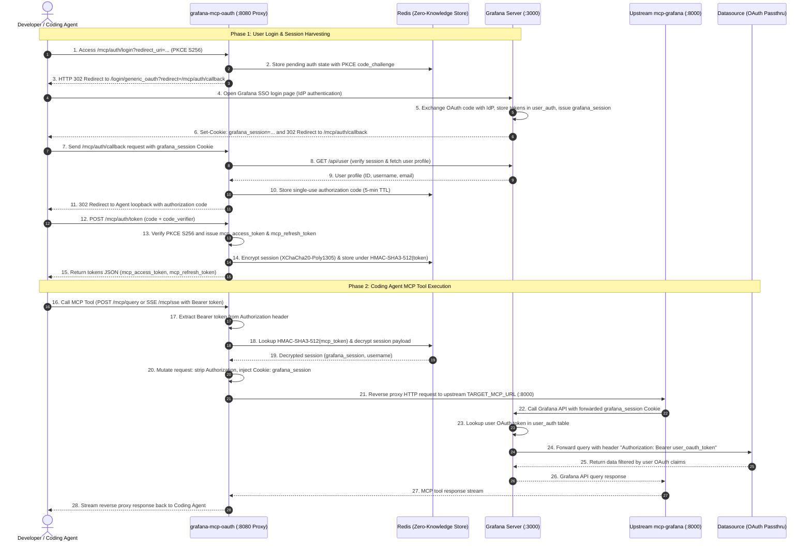
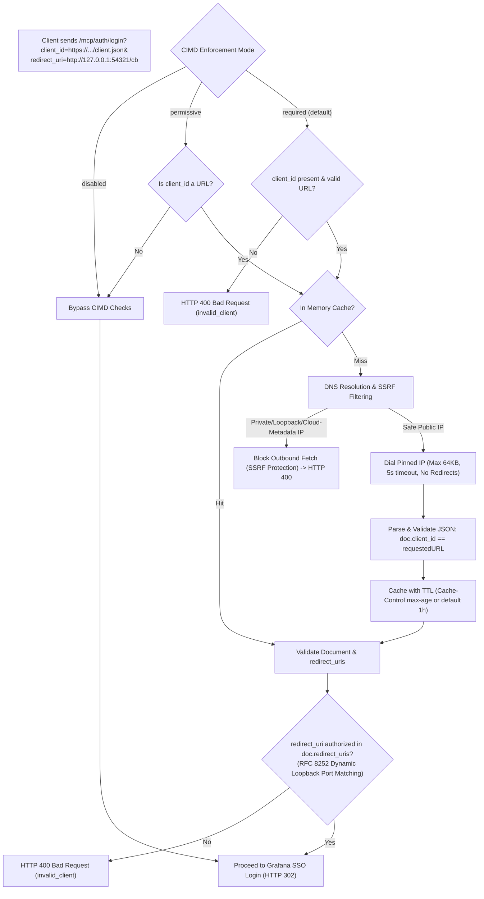

# Architecture Specification: Grafana MCP OAuth Gateway

Detailed architectural specification for centralized OIDC authentication for Grafana MCP while preserving the Datasource OAuth Passthru mechanism.

---

## 1. Background & Technical Challenges

### 1.1. Grafana's Generic OAuth & Datasource Passthru Mechanism
In Grafana Server:
1. When `[auth.generic_oauth]` is configured, users authenticate via the OAuth 2.0 Authorization Code Flow.
2. Grafana Server directly communicates with the Identity Provider (IdP) to exchange the authorization code for an Access Token, ID Token, and Refresh Token.
3. Grafana stores these tokens in the `user_auth` table of its internal database.
4. Grafana issues a `grafana_session` session cookie to the browser.
5. When the user executes queries against a Data Source (e.g., Prometheus, Loki, ClickHouse, Elasticsearch) with the following setting enabled:
   ```ini
   oauth_pass_thru = true
   ```
   Grafana Server relies on `grafana_session` to look up the user's Access Token in the `user_auth` table and injects this token into the `Authorization: Bearer <user_oauth_token>` header sent to the upstream Data Source. This allows the Data Source to enforce accurate role-based access control (RBAC) according to the user's claims and roles.

### 1.2. Challenges for Grafana MCP Server
* The stock default MCP Server (`mcp-grafana`) connects to Grafana using a static `GRAFANA_SERVICE_ACCOUNT_TOKEN`.
* If the MCP Server uses a static Service Account, Grafana has **no user OAuth token** in the request context, causing queries against Data Sources with `oauth_pass_thru = true` to be denied or evaluated under incorrect permissions.
* Grafana does not provide a public API allowing external clients to send a Bearer token to self-create a `grafana_session` linked to an OAuth token in the `user_auth` table.
* Therefore, every request from the MCP Server to the Grafana API **must carry the user's actual `grafana_session` cookie** issued from Grafana's SSO login flow.

---

## 2. Architecture Solutions: Envoy Gateway & Direct Sidecar Proxy

The solution adopts a layered architecture supporting two primary deployment models without requiring any forks or modifications to the upstream source code of `grafana/mcp-grafana`:

### 2.1. Architecture A: Centralized Envoy Gateway (`MODE=extauthz`)

Envoy Gateway acts as the central ingress. Regular Grafana web traffic bypasses external authorization, while MCP traffic is intercepted by Envoy's `ext_authz` filter. `grafana-mcp-oauth` validates the Bearer token against Redis, injects the user's `grafana_session` cookie, and strips the Authorization header before forwarding to stock `mcp-grafana`:



### 2.2. Architecture B: Direct Sidecar Proxy (`MODE=proxy`)

`grafana-mcp-oauth` runs as a standalone gateway or pod sidecar directly fronting stock `mcp-grafana` (`TARGET_MCP_URL`) without requiring Envoy. It terminates OAuth handshakes, validates Bearer tokens, injects `grafana_session` cookies, and reverse-proxies directly to upstream MCP:



---

## 3. Authentication & Query Sequence (End-to-End Sequence)

### 3.1. Architecture A: Envoy Gateway Mode (`MODE=extauthz`) Sequence



### 3.2. Architecture B: Direct Sidecar Proxy Mode (`MODE=proxy`) Sequence



---

## 4. Zero-Knowledge Cryptography Security Model

The system establishes multi-layered session security to ensure end-to-end protection:

### 4.1. Token Key Hashing
* **Algorithm**: `HMAC-SHA3-512` (FIPS 202).
* **Purpose**: Hashes client tokens to serve as lookup keys in Redis.
* **Properties**: Even if the entire Redis database is extracted or dumped, attackers cannot reverse engineer user tokens or perform offline rainbow table attacks without the Server Master Secret.

### 4.2. Session Data Encryption (Encryption at Rest)
* **Algorithm**: `XChaCha20-Poly1305` (Authenticated Encryption with Associated Data - AEAD).
* **Nonce Size**: 192-bit (24 bytes) random per write, eliminating nonce collision risks.
* **Encryption Key**: Independently derived per session from the client token using `HKDF-SHA3-512` (with Argon2id supported for master secret derivation).
* **Zero-Knowledge**: Only clients possessing a valid token can derive the key required to decrypt the session payload. The Redis server stores no decryption keys.
* **Distributed State**: All pending login states (`mcp:pending_auth:`) and authorization codes (`mcp:auth_code:`) are stored centrally in Redis with automatic TTLs, fully supporting horizontal autoscaling (Multi-replica / HPA).

### 4.3. Transport Encryption & Dynamic Mutual TLS (mTLS)
* **Transport Encryption**: Supports TLS 1.2+ for in-transit encryption against Redis servers (`REDIS_TLS_ENABLED`), with support for custom CA certificate bundles (`REDIS_CA_PATH`) or automatic fallback to host system root CAs.
* **Mutual TLS (mTLS)**: Supports client authentication via client certificate (`REDIS_CERT_PATH`) and private key (`REDIS_KEY_PATH`).
* **Zero-Downtime Dynamic Auto-Reload**: Implements Go's `crypto/tls.Config.GetClientCertificate` callback with thread-safe `KeyPairReloader`. File modification timestamps (`os.Stat`) are checked during TLS handshakes. When certificates or keys are rotated on disk (e.g. by cert-manager or Kubernetes projected volume updates), new connections automatically adopt the updated credentials without requiring a process restart. Disk reads and key parsing occur outside exclusive locks to eliminate contention during handshakes.
* **Fail-Safe Operation**: If a file read or parse error occurs during cert rotation (e.g., transient half-write or lock), the gateway logs a warning and retains the currently active valid certificate, preventing service degradation.

---

## 5. Client ID Metadata Document (CIMD) & Zero-Trust Client Verification

Per `draft-ietf-oauth-client-id-metadata-document`, Model Context Protocol (MCP) clients can dynamically authenticate to authorization servers without requiring manual pre-registration or stateful Dynamic Client Registration (RFC 7591) endpoints.

### 5.1. Enforcement Lifecycle & Validation Flow



### 5.2. Defense-in-Depth Architecture
1. **SSRF Prevention & DNS Pinning**: Outbound fetches resolve hostnames via `net.Resolver` and inspect all returned IP addresses against a comprehensive CIDR blacklist:
   - IPv4: Loopback (`127.0.0.0/8`), Private networks (`10.0.0.0/8`, `172.16.0.0/12`, `192.168.0.0/16`), Link-local / Cloud metadata service (`169.254.0.0/16`, targeting `169.254.169.254`), Shared address space (`100.64.0.0/10`), Multicast, and Reserved networks.
   - IPv6: Loopback (`::1/128`), ULA (`fc00::/7`), Link-local (`fe80::/10`), Multicast (`ff00::/8`).
   - The connection dials the validated IP directly (`safeIP:port`), effectively defeating DNS Rebinding attacks.
   - Redirects are strictly prohibited on metadata fetches to prevent redirect-based SSRF.
2. **RFC 8252 Section 7.3 Ephemeral Port Compatibility**: Native MCP coding agents (Cursor, Claude Desktop, Antigravity) listen on random ephemeral loopback ports (`http://127.0.0.1:<port>/callback` or `http://localhost:<port>/callback`). `pkg/cimd` verifies that the scheme, host category (loopback), and path match an authorized loopback URI in the client document, allowing arbitrary local ports while strictly enforcing exact matching for non-loopback URLs.
3. **In-Memory Thread-Safe Cache**: Eliminates redundant outbound fetches and protects client metadata servers from DoS. Bounded to 64KB per document with a 5-second HTTP deadline.

---

## 6. Unified Runtime & Operating Modes

The gateway is built as a single, multi-architecture static binary (`grafana-mcp-oauth`) packaged into a minimal Distroless runtime (`gcr.io/distroless/static-debian12:nonroot`). It supports three distinct modes:

1. **`proxy` Mode (`--mode=proxy`, default)**:
   - Starts an authenticated reverse proxy directly fronting stock `mcp-grafana` (`TARGET_MCP_URL`).
   - Serves OAuth 2.1 RFC 9728 discovery and PKCE endpoints on HTTP (`PORT`, default `8080`).
   - Validates incoming `Authorization: Bearer <token>`, decrypts user's `grafana_session` cookie via Zero-Knowledge session store, injects `Cookie: grafana_session=...`, strips `Authorization`, and proxies to upstream MCP.
   - Ideal for Kubernetes sidecar containers or standalone lightweight deployments without Envoy.

2. **`extauthz` Mode (`--mode=extauthz`)**:
   - Starts the Envoy gRPC external authorization server (`GRPC_PORT`, default `9001`) and HTTP check endpoint (`HTTP_PORT`, default `8081`).
   - Serves OAuth 2.1 discovery and PKCE endpoints.
   - Ideal for centralized deployments behind Envoy Gateway, Traefik, or Ingress controllers.

3. **`all` Mode (`--mode=all`)**:
   - Enables both `proxy` and `extauthz` services concurrently in the same process.
   - Ideal for unified deployments, multi-tenant gateways, or local development environments.

---

## 7. Project File Layout

```
.
├── cmd
│   ├── demo-runner
│   │   └── main.go                 # Local demo simulation runner
│   └── grafana-mcp-oauth
│       └── main.go                 # Unified Gateway entrypoint (proxy, extauthz, all modes)
├── pkg
│   ├── cimd
│   │   ├── cache.go                # Thread-safe in-memory cache with TTL support
│   │   ├── document.go             # CIMD Document model, RFC 8252 loopback matching & validation
│   │   ├── fetcher.go              # Document fetcher, URL syntax checks, Cache-Control parsing
│   │   ├── ssrf.go                 # SSRF safe dialer, DNS pinning, private/cloud IP blacklist
│   │   └── cimd_test.go            # Comprehensive unit tests for CIMD validation & SSRF defense
│   ├── config
│   │   ├── config.go               # Configuration loader supporting MODE, port, and CIMD settings
│   │   └── config_test.go          # Config unit tests
│   ├── server
│   │   ├── server.go               # Unified Server managing HTTP Mux, gRPC, and Proxy
│   │   ├── server_test.go          # Unit tests verifying proxy, extauthz, and all modes
│   │   ├── tls.go                  # Redis TLS/mTLS config and thread-safe dynamic keypair reloader
│   │   └── tls_test.go             # Unit tests for TLS, custom CA, mTLS, and dynamic cert rotation
│   ├── crypto
│   │   ├── crypto.go               # HMAC-SHA3-512, HKDF, Argon2id, XChaCha20-Poly1305
│   │   └── crypto_test.go          # Unit tests for encryption, hashing, and tamper resistance
│   ├── extauthz
│   │   ├── server.go               # Envoy gRPC AuthorizationServer & HTTP check endpoint
│   │   └── server_test.go          # Unit tests for gRPC Check and header mutation
│   ├── oauth
│   │   ├── handler.go              # OAuth SSO login, callback, session harvesting, token refresh
│   │   └── handler_test.go         # Unit tests for OAuth flow and auto-refresh
│   ├── proxy
│   │   ├── proxy.go                # Authenticated HTTP reverse proxy to stock mcp-grafana
│   │   └── proxy_test.go           # Reverse proxy tests
│   └── store
│       ├── store.go                # Redis Session Store interface and Zero-Knowledge encryption
│       └── store_test.go           # Miniredis unit tests validating security at storage layer
├── deploy
│   ├── docker-compose.yml          # Mode extauthz: Envoy Gateway + grafana-mcp-oauth + Redis + Grafana
│   ├── docker-compose.sidecar.yml  # Mode proxy: Direct Sidecar Proxy + Redis + mcp-grafana
│   ├── k8s-sidecar.yaml            # Kubernetes sidecar pod deployment template
│   └── envoy
│       ├── envoy.yaml              # Envoy Proxy configuration with routing and ext_authz filter
│       └── gateway-api.yaml        # Kubernetes Gateway API manifests (Envoy Gateway)
├── test
│   ├── e2e_test.go                 # Comprehensive End-to-End integration test suite (both architectures)
│   └── real_agent_flow.py          # Python simulation of coding agent PKCE loopback handshake
├── Dockerfile                      # Single multi-arch (amd64/arm64) Distroless Dockerfile
├── Makefile                        # Multi-arch build and test automation
├── ARCHITECTURE.md                 # Detailed architecture specification (this document)
└── README.md                       # Overview and quick-start deployment guide
```
