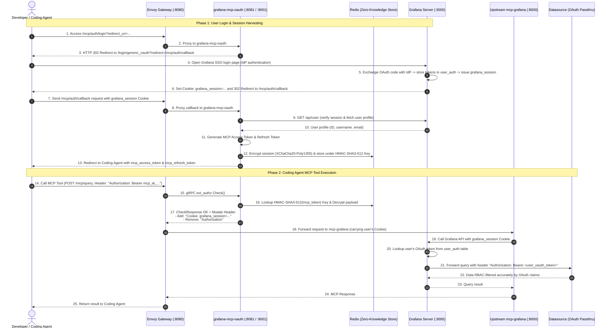

# Architecture Specification: Grafana MCP OAuth Gateway

Detailed architectural specification for centralized OIDC authentication for Grafana MCP while preserving the Datasource OAuth Passthru mechanism.

---

## 1. Background & Technical Challenges

### 1.1. Grafana's Generic OAuth & Datasource Passthru Mechanism
In Grafana Server:
1. When `[auth.generic_oauth]` is configured, users authenticate via the OAuth 2.0 Authorization Code Flow.
2. Grafana Server directly communicates with the Identity Provider (IdP) to exchange the authorization code for an Access Token, ID Token, and Refresh Token.
3. Grafana stores these tokens in the `user_auth` table of its internal database.
4. Grafana issues a `grafana_session` session cookie to the browser.
5. When the user executes queries against a Data Source (e.g., Prometheus, Loki, ClickHouse, Elasticsearch) with the following setting enabled:
   ```ini
   oauth_pass_thru = true
   ```
   Grafana Server relies on `grafana_session` to look up the user's Access Token in the `user_auth` table and injects this token into the `Authorization: Bearer <user_oauth_token>` header sent to the upstream Data Source. This allows the Data Source to enforce accurate role-based access control (RBAC) according to the user's claims and roles.

### 1.2. Challenges for Grafana MCP Server
* The stock default MCP Server (`mcp-grafana`) connects to Grafana using a static `GRAFANA_SERVICE_ACCOUNT_TOKEN`.
* If the MCP Server uses a static Service Account, Grafana has **no user OAuth token** in the request context, causing queries against Data Sources with `oauth_pass_thru = true` to be denied or evaluated under incorrect permissions.
* Grafana does not provide a public API allowing external clients to send a Bearer token to self-create a `grafana_session` linked to an OAuth token in the `user_auth` table.
* Therefore, every request from the MCP Server to the Grafana API **must carry the user's actual `grafana_session` cookie** issued from Grafana's SSO login flow.

---

## 2. Architecture Solution: Envoy Gateway + `grafana-mcp-oauth`

The solution adopts a layered architecture:

```
+-----------------------------------------------------------------------------------------+
|                                    CLIENT TIER                                          |
|                                                                                         |
|        [Web Browser User]                             [Coding Agent / MCP Client]       |
|                 |                                                  |                    |
+-----------------|--------------------------------------------------|--------------------+
                  |                                                  |
                  |                                                  | Bearer MCP_Token
                  v                                                  v
+-----------------------------------------------------------------------------------------+
|                                  ENVOY GATEWAY TIER                                     |
|                                                                                         |
|   /dashboards, /explore, /                /mcp/auth/*                /mcp/*             |
|   (Bypass ext_authz)                      (Bypass ext_authz)         (Enforces ext_authz)
|          |                                     |                           |            |
+----------|-------------------------------------|---------------------------|------------+
           |                                     |                           |
           |                                     v                           v
           |                        +-----------------------+   +------------------------+
           |                        |   grafana-mcp-oauth   |   | gRPC Check()           |
           |                        |   - /mcp/auth/login   |<--| - Validates Token      |
           |                        |   - /mcp/auth/callback|   | - Injects Cookie       |
           |                        |   - /mcp/auth/token   |   | - Strips Authorization |
           |                        +-----------------------+   +------------------------+
           |                                     |                           |
           |                                     v                           |
           |                        +-----------------------+                |
           |                        |   Zero-Knowledge      |                |
           |                        |   Redis Session Store |<---------------+
           |                        +-----------------------+                |
           |                                                                 v (with Cookie)
+----------|------------------------------------------------------------------------------+
|          |                         MCP PROCESSING TIER                                  |
|          |                                                                              |
|          |                                +-----------------------------------+         |
|          |                                | stock grafana/mcp-grafana:latest  |         |
|          |                                | GRAFANA_FORWARD_HEADERS=Cookie    |         |
|          |                                +-----------------------------------+         |
|          |                                                  |                           |
+----------|--------------------------------------------------|---------------------------+
           |                                                  | Cookie: grafana_session
           v                                                  v
+-----------------------------------------------------------------------------------------+
|                                   GRAFANA & DATA TIER                                   |
|                                                                                         |
|                                  [Grafana Server]                                       |
|                                  - Resolves grafana_session                             |
|                                  - Extracts OAuth token from user_auth                  |
|                                  - Applies oauth_pass_thru = true                       |
|                                         |                                               |
|                                         v Bearer <user_oauth_token>                     |
|                                  [Data Sources]                                         |
|                                  (Prometheus / Loki / Tempo)                            |
+-----------------------------------------------------------------------------------------+
```

---

## 3. Authentication & Query Sequence (End-to-End Sequence)



---

## 4. Zero-Knowledge Cryptography Security Model

The system establishes multi-layered session security to ensure end-to-end protection:

### 4.1. Token Key Hashing
* **Algorithm**: `HMAC-SHA3-512` (FIPS 202).
* **Purpose**: Hashes client tokens to serve as lookup keys in Redis.
* **Properties**: Even if the entire Redis database is extracted or dumped, attackers cannot reverse engineer user tokens or perform offline rainbow table attacks without the Server Master Secret.

### 4.2. Session Data Encryption (Encryption at Rest)
* **Algorithm**: `XChaCha20-Poly1305` (Authenticated Encryption with Associated Data - AEAD).
* **Nonce Size**: 192-bit (24 bytes) random per write, eliminating nonce collision risks.
* **Encryption Key**: Independently derived per session from the client token using `HKDF-SHA3-512` (with Argon2id supported for master secret derivation).
* **Zero-Knowledge**: Only clients possessing a valid token can derive the key required to decrypt the session payload. The Redis server stores no decryption keys.
* **Distributed State**: All pending login states (`mcp:pending_auth:`) and authorization codes (`mcp:auth_code:`) are stored centrally in Redis with automatic TTLs, fully supporting horizontal autoscaling (Multi-replica / HPA).

---

## 5. Unified Runtime & Operating Modes

The gateway is built as a single, multi-architecture static binary (`grafana-mcp-oauth`) packaged into a minimal Distroless runtime (`gcr.io/distroless/static-debian12:nonroot`). It supports three distinct modes:

1. **`proxy` Mode (`--mode=proxy`, default)**:
   - Starts an authenticated reverse proxy directly fronting stock `mcp-grafana` (`TARGET_MCP_URL`).
   - Serves OAuth 2.1 RFC 9728 discovery and PKCE endpoints on HTTP (`PORT`, default `8080`).
   - Validates incoming `Authorization: Bearer <token>`, decrypts user's `grafana_session` cookie via Zero-Knowledge session store, injects `Cookie: grafana_session=...`, strips `Authorization`, and proxies to upstream MCP.
   - Ideal for Kubernetes sidecar containers or standalone lightweight deployments without Envoy.

2. **`extauthz` Mode (`--mode=extauthz`)**:
   - Starts the Envoy gRPC external authorization server (`GRPC_PORT`, default `9001`) and HTTP check endpoint (`HTTP_PORT`, default `8081`).
   - Serves OAuth 2.1 discovery and PKCE endpoints.
   - Ideal for centralized deployments behind Envoy Gateway, Traefik, or Ingress controllers.

3. **`all` Mode (`--mode=all`)**:
   - Enables both `proxy` and `extauthz` services concurrently in the same process.
   - Ideal for unified deployments, multi-tenant gateways, or local development environments.

---

## 6. Project File Layout

```
.
├── cmd
│   ├── demo-runner
│   │   └── main.go                 # Local demo simulation runner
│   └── grafana-mcp-oauth
│       └── main.go                 # Unified Gateway entrypoint (proxy, extauthz, all modes)
├── pkg
│   ├── config
│   │   ├── config.go               # Configuration loader supporting MODE and port overrides
│   │   └── config_test.go          # Config unit tests
│   ├── server
│   │   ├── server.go               # Unified Server managing HTTP Mux, gRPC, and Proxy
│   │   └── server_test.go          # Unit tests verifying proxy, extauthz, and all modes
│   ├── crypto
│   │   ├── crypto.go               # HMAC-SHA3-512, HKDF, Argon2id, XChaCha20-Poly1305
│   │   └── crypto_test.go          # Unit tests for encryption, hashing, and tamper resistance
│   ├── extauthz
│   │   ├── server.go               # Envoy gRPC AuthorizationServer & HTTP check endpoint
│   │   └── server_test.go          # Unit tests for gRPC Check and header mutation
│   ├── oauth
│   │   ├── handler.go              # OAuth SSO login, callback, session harvesting, token refresh
│   │   └── handler_test.go         # Unit tests for OAuth flow and auto-refresh
│   ├── proxy
│   │   ├── proxy.go                # Authenticated HTTP reverse proxy to stock mcp-grafana
│   │   └── proxy_test.go           # Reverse proxy tests
│   └── store
│       ├── store.go                # Redis Session Store interface and Zero-Knowledge encryption
│       └── store_test.go           # Miniredis unit tests validating security at storage layer
├── deploy
│   ├── docker-compose.yml          # Mode extauthz: Envoy Gateway + grafana-mcp-oauth + Redis + Grafana
│   ├── docker-compose.sidecar.yml  # Mode proxy: Direct Sidecar Proxy + Redis + mcp-grafana
│   ├── k8s-sidecar.yaml            # Kubernetes sidecar pod deployment template
│   └── envoy
│       ├── envoy.yaml              # Envoy Proxy configuration with routing and ext_authz filter
│       └── gateway-api.yaml        # Kubernetes Gateway API manifests (Envoy Gateway)
├── test
│   ├── e2e_test.go                 # Comprehensive End-to-End integration test suite (both architectures)
│   └── real_agent_flow.py          # Python simulation of coding agent PKCE loopback handshake
├── Dockerfile                      # Single multi-arch (amd64/arm64) Distroless Dockerfile
├── Makefile                        # Multi-arch build and test automation
├── ARCHITECTURE.md                 # Detailed architecture specification (this document)
└── README.md                       # Overview and quick-start deployment guide
```
