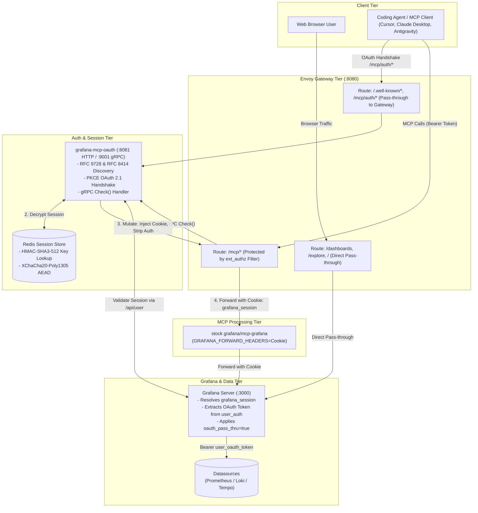
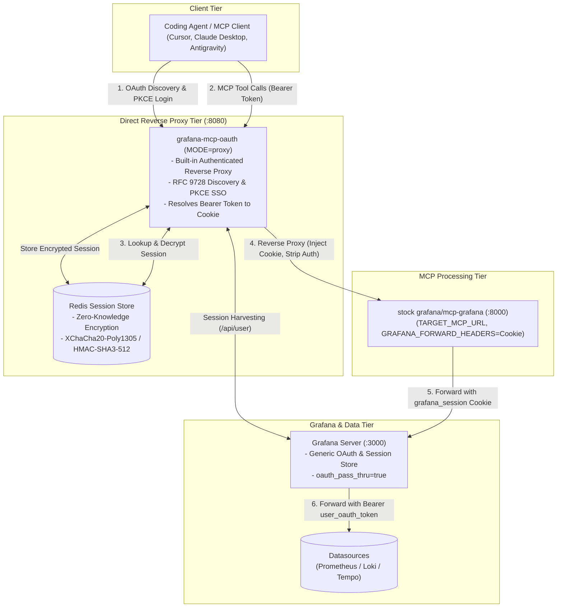

# Grafana MCP OAuth & Centralized Remote Gateway

[](https://deepwiki.com/devopssavvy/grafana-mcp-oauth)

Centralized security and authentication layer for **Grafana Model Context Protocol (MCP) Server** combining **Envoy Gateway** and a **Zero-Knowledge Session Store**, enabling Coding Agents (such as Cursor, Claude Desktop, Antigravity) to connect remotely and fully automatically via **MCP Dynamic OAuth Discovery (RFC 9728 & RFC 8414)** while preserving Grafana's **Datasource OAuth Passthru** mechanism.

> **Zero-Manual-Input Experience**: The user **only needs to enter the MCP Server URL** into the coding agent. The client and browser automatically perform the OAuth 2.1 PKCE handshake to grant authorization without requiring manual copying or pasting of any tokens!

---

## 1. Architectural Overview

Grafana Server uses Generic OAuth combined with `oauth_pass_thru = true` on Data Sources (Prometheus, Loki, Tempo...) to enforce data access control based on user OAuth claims. When users log in via the web UI, Grafana issues a session cookie (`grafana_session`) and maps it to their OAuth tokens in an internal database table.

This project implements a **Centralized Gateway (`grafana-mcp-oauth`)** architecture **without requiring any forks or modifications to the upstream source code** of `grafana/mcp-grafana`. It supports two flexible deployment architectures:

### Architecture A: Centralized Envoy Gateway (`MODE=extauthz`)

Envoy Gateway acts as the central ingress. Regular Grafana web traffic bypasses external authorization, while MCP traffic is intercepted by Envoy's `ext_authz` HTTP/gRPC filter. `grafana-mcp-oauth` validates the Bearer token against Redis, injects the user's `grafana_session` cookie, and strips the Authorization header before forwarding to stock `mcp-grafana`:



### Architecture B: Direct Sidecar Proxy (`MODE=proxy`)

`grafana-mcp-oauth` runs as a lightweight, authenticated reverse proxy directly fronting stock `mcp-grafana` (`TARGET_MCP_URL`) without requiring Envoy. Ideal for Kubernetes sidecars or standalone lightweight setups:



---

## 2. Core Components

### 2.1. Unified Gateway Binary & Image: `grafana-mcp-oauth` (Go 1.27.3)
Central service packaged into a **single, minimal Distroless image** (`gcr.io/distroless/static-debian12:nonroot`, <10MB) supporting **multi-architecture builds (`linux/amd64` and `linux/arm64`)** via Docker Buildx.

It operates in 3 distinct modes, configurable via CLI flag `--mode` or environment variable `MODE`:

| Mode | HTTP Port | gRPC Port (9001) | Reverse Proxy `/mcp/*` | ext_authz (gRPC + HTTP Check) | Use Case |
| :--- | :---: | :---: | :---: | :---: | :--- |
| **`proxy`** *(Default)* | 8080 | Disabled | Enabled (`TARGET_MCP_URL`) | Disabled | Standalone or Kubernetes Sidecar without Envoy |
| **`extauthz`** | 8081 | Enabled | Disabled | Enabled | Deployment behind Envoy Gateway or Ingress |
| **`all`** | 8080 | Enabled | Enabled (`TARGET_MCP_URL`) | Enabled | Hybrid / all-in-one local dev & versatile setups |

Key capabilities:
1. **MCP Dynamic OAuth Discovery (RFC 9728 & RFC 8414)**:
   - `GET /.well-known/oauth-protected-resource`: Provides protected resource metadata per RFC 9728 so MCP clients automatically discover the Authorization Server.
   - `GET /.well-known/oauth-authorization-server`: Provides `authorization_endpoint`, `token_endpoint`, and supports PKCE `S256`.
2. **OAuth 2.1 PKCE Authorization Code Flow**:
   - `GET /mcp/auth/login`: Triggers browser authentication via Grafana Generic OAuth (`/login/generic_oauth?redirect=/mcp/auth/callback`). Enforces PKCE `S256` per RFC 9700. Prevents Open Redirect by strictly validating `redirect_uri` to loopback local interfaces only (`http://localhost`, `http://127.0.0.1`, `http://[::1]`) and prohibiting URI fragments. Sets browser cookie `mcp_auth_state` (SameSite=Lax, HttpOnly) to completely eliminate OAuth Login CSRF.
   - `GET /mcp/auth/callback`: Validates the `mcp_auth_state` cookie, captures the `grafana_session` cookie from Grafana's response, verifies identity via `/api/user` (strictly rejecting forged sessions), issues a single-use authorization code `mcp_code_...` encrypted and stored in Redis with a 5-minute TTL, then redirects back to the client loopback.
   - `POST /mcp/auth/token`: Validates authorization code and `code_verifier` using constant-time comparison (`subtle.ConstantTimeCompare`), strictly verifies exact `redirect_uri` match per RFC 6749 Section 4.1.3, and issues JSON `mcp_access_token` and `mcp_refresh_token` pairs with a `Cache-Control: no-store` header. Supports `grant_type=refresh_token` flow with atomic token rotation and proactive Grafana session liveness checks.

### 2.2. Zero-Knowledge Cryptographic Storage & Distributed State in Redis
* **Distributed State**: All pending login states (`mcp:pending_auth:`) and authorization codes (`mcp:auth_code:`) are distributed in Redis with automatic TTLs, fully supporting horizontal scaling (Horizontal Pod Autoscaling / Multi-replica).
* **Pure Client-Derived Key (RFC 5869 Zero-Config Mode)**:
  - Eliminates the need for administrators to manage `MCP_MASTER_SECRET`.
  - The Redis lookup key is computed using **HMAC-SHA3-512** over the 256-bit entropy token using a standard deterministic domain-separation salt (`grafana-mcp-oauth-v1-domain-salt`):
    $$\text{RedisKey} = \text{mcp:session:} + \text{HMAC-SHA3-512}(\text{token}, \text{DomainSalt})$$
  - Since tokens are generated using cryptographically secure random bytes ($2^{256}$ states), rainbow table precomputation and offline brute force are mathematically impossible.
* **Payload Encryption**: Encrypted with **XChaCha20-Poly1305** (AEAD with 192-bit / 24-byte random nonce).
* **Key Derivation (KDF)**: A 256-bit encryption key is independently derived per session directly from the client token via **HKDF-SHA3-512** for sub-0.1ms performance.
* *Zero-Knowledge Guarantee: No one (including database administrators or attackers with full Redis dumps) can inspect the `grafana_session` or user identity without the raw bearer token possessed only by the client.*

### 2.3. Redis TLS & Dynamic Mutual TLS (mTLS)
In enterprise environments and secure cloud infrastructures (e.g. AWS ElastiCache, Redis Enterprise, Upstash, or internal Kubernetes service meshes), Redis connections can be encrypted in-transit via TLS or authenticated via mutual TLS (mTLS):

| Environment Variable | Type | Default | Description |
| :--- | :---: | :---: | :--- |
| **`REDIS_TLS_ENABLED`** | bool | `false` | Enables TLS transport encryption (MinVersion: TLS 1.2). Auto-enabled if cert paths or SNI are provided. |
| **`REDIS_CA_PATH`** | string | `""` | Path to custom CA PEM bundle. If unset and TLS is enabled, system root CAs are used. |
| **`REDIS_CERT_PATH`** | string | `""` | Path to client certificate PEM for mTLS client authentication. |
| **`REDIS_KEY_PATH`** | string | `""` | Path to client private key PEM for mTLS client authentication. |
| **`REDIS_TLS_SERVER_NAME`** | string | `""` | Optional Server Name Indication (SNI) override. |
| **`REDIS_TLS_INSECURE_SKIP_VERIFY`** | bool | `false` | Disables server certificate verification (for local development or testing). |

* **Zero-Downtime Dynamic Auto-Reload**: The client certificate and key are managed by a thread-safe `GetClientCertificate` reloader that checks file modification timestamps (`os.Stat`) on TLS handshakes. When certificates are rotated on disk (e.g., via cert-manager or Kubernetes Secret/ConfigMap projected volume updates), new connections automatically adopt the updated certificate without requiring a gateway restart. If a file is temporarily malformed during rotation, the gateway safely retains the existing active certificate.

### 2.4. Upstream `grafana/mcp-grafana` (Zero-Fork)
Uses the official 100% stock Grafana Labs container image (`grafana/mcp-grafana:latest`). Leverages built-in capabilities in `mcp-grafana`'s Go codebase:
```bash
GRAFANA_URL=http://grafana:3000
GRAFANA_FORWARD_HEADERS=Cookie
```
`mcp-grafana` automatically recognizes the `grafana_session` cookie forwarded by Envoy and passes it unaltered to the Grafana API.

---

## 3. Deployment & Build Guide

### 3.1. Building the Unified Image (Distroless & Multi-Arch)

```bash
# Build local image
make docker-build
# or: docker build --network=host -t grafana-mcp-oauth:latest .

# Build multi-architecture image (AMD64 + ARM64)
make docker-build-multiarch
# or: docker buildx build --network=host --platform linux/amd64,linux/arm64 -t grafana-mcp-oauth:latest .
```

### 3.2. Running Architecture A: Envoy Gateway (`MODE=extauthz`)

In this architecture, Envoy handles edge routing, Grafana web traffic bypasses auth, and MCP calls are protected via Envoy gRPC `ext_authz`:

```bash
cd deploy
docker compose up -d
```

Service Ports:
* **`:8080`**: Unified Envoy Gateway Ingress port (serving both Grafana Web and MCP).
* **`127.0.0.1:9901`**: Envoy Admin (listening strictly on localhost/loopback).

### 3.3. Running Architecture B: Direct Sidecar Proxy (`MODE=proxy`)

In this architecture, `grafana-mcp-oauth` runs as a lightweight direct reverse proxy sidecar fronting stock `mcp-grafana` without requiring Envoy:

```bash
cd deploy
docker compose -f docker-compose.sidecar.yml up -d
```

Service Ports:
* **`:8080`**: Front-door Proxy port for Coding Agents.

---

## 4. Client Configuration Guide (Fully Automated - Zero Token Entry)

Users **only need to enter the URL** into the MCP client configuration file.

### For Cursor (`.cursor/mcp.json`):
```json
{
  "mcpServers": {
    "grafana-remote": {
      "url": "http://<gateway-host>:8080/mcp/sse"
    }
  }
}
```

### For Claude Desktop (`claude_desktop_config.json`):
```json
{
  "mcpServers": {
    "grafana": {
      "command": "npx",
      "args": ["-y", "@modelcontextprotocol/server-sse", "http://<gateway-host>:8080/mcp/sse"]
    }
  }
}
```

### Automated Flow:
1. When the Agent first connects to `http://<gateway-host>:8080/mcp/sse`, the Gateway returns `401` along with `resource_metadata` discovery hints.
2. The Agent automatically fetches `/.well-known/oauth-protected-resource` and launches a temporary local web server on the developer's machine.
3. The default web browser automatically opens the Grafana SSO login page.
4. Upon successful authentication, the browser redirects the authorization code back to the local Agent.
5. The Agent automatically exchanges the code for tokens and persists them securely on your local machine.
6. All Prometheus/Loki queries from the Agent immediately execute with your exact user authorization and claims!

---

## 5. Running the Test Suite

The entire test suite is self-contained, leveraging `miniredis` and `httptest` (no external service dependencies required):

```bash
# Run all unit tests and E2E integration tests with the Go Data Race Detector enabled
go test -v -count=1 -race ./...
```

100% verified automated test scenarios:
- [x] **`pkg/crypto`**: Verifies HMAC-SHA3-512, HKDF-SHA3-512, Argon2id, XChaCha20-Poly1305 AEAD encryption/decryption, and tamper resistance.
- [x] **`pkg/store`**: Verifies Zero-Knowledge encryption in Redis, ensures raw storage contains no plaintext tokens or sessions, verifies session updates and refresh token rotation.
- [x] **`pkg/oauth`**: Verifies RFC 9728 & RFC 8414 metadata, blocks Open Redirects against external redirect_uris, rejects forged sessions, and validates the complete PKCE S256 lifecycle and refresh flow.
- [x] **`pkg/extauthz`**: Verifies gRPC Check requests, verifies RFC 9728 challenge headers on missing tokens, extracts Bearer tokens, strips Authorization headers, and injects `Cookie: grafana_session=...`.
- [x] **`test/e2e_test.go`**: Simulates the complete End-to-End flow: Web User, Coding Agent automated MCP OAuth Discovery, Envoy Gateway, `mcp-grafana`, and Grafana Datasource OAuth Passthru.

## License

This project is licensed under the Apache 2.0 License - see the [LICENSE](LICENSE) file for details.
