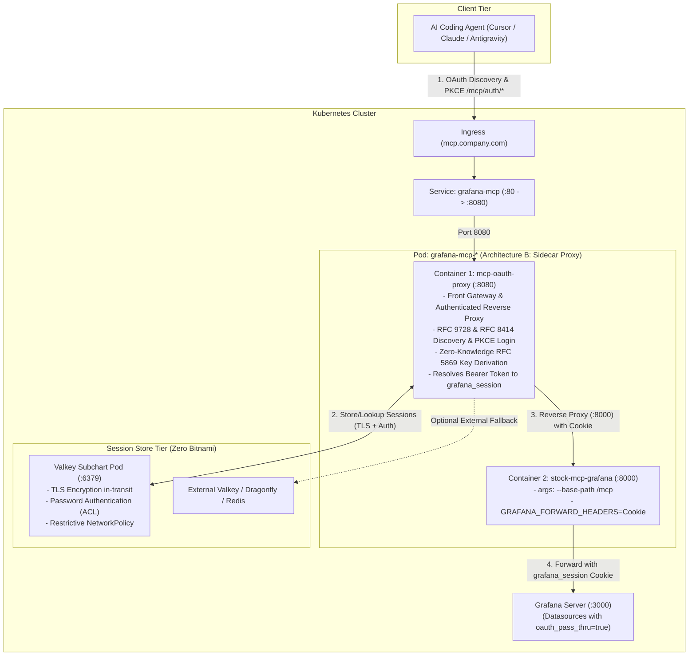

# Grafana MCP Helm Chart (with OAuth 2.1 Sidecar Proxy)

[](https://artifacthub.io)
[](LICENSE)

Production-grade Helm chart deploying the **Grafana Model Context Protocol (MCP) Server** with **`grafana-mcp-oauth`** running as an authenticated reverse proxy sidecar and a hardened **Valkey** session store (zero Bitnami dependencies).

Enables AI coding agents (**Cursor, Claude Desktop, Antigravity**) to connect remotely to Grafana MCP via **RFC 9728 & RFC 8414 OAuth 2.1 discovery** while preserving Grafana's native **Datasource OAuth Token Passthrough** (`oauth_pass_thru=true`).

---

## 1. Architectural Overview



---

## 2. Key Features

- **Co-Located Sidecar:** Automatically provisions `mcp-oauth-proxy` (:8080) and unmodified `grafana/mcp-grafana` (:8000) within the same Pod. Localhost proxying incurs zero cluster network hop latency.
- **Zero-Manual-Input Client Experience:** Users simply input the MCP endpoint URL into their coding agent. Discovery, authorization URL negotiation, and token issuance occur automatically via browser PKCE login.
- **Zero-Knowledge RFC 5869 Security:** In-session Grafana tokens are encrypted using client-derived keys without requiring a cluster-wide master encryption secret or multi-pod secret synchronization.
- **Hardened Valkey Session Store (Zero Bitnami):** Bundles the official Linux Foundation [Valkey Helm chart](https://valkey.io/valkey-helm/) with mutual TLS (mTLS), password authentication, and fine-grained Kubernetes `NetworkPolicy` isolating Valkey port 6379 strictly to the proxy pods.
- **Production Kubernetes Primitives:** Complete templates for Ingress, ServiceAccount, HPA, PodDisruptionBudget, ServiceMonitor, and strict Pod Security Standards (`runAsNonRoot: true`, `drop: [ALL]`, `readOnlyRootFilesystem: true`).

---

## 3. Installation

### Quick Start (Bundled Valkey)

To deploy with in-cluster secure Valkey session storage:

```bash
# Add Valkey repository
helm repo add valkey https://valkey.io/valkey-helm/
helm repo update

# Build chart dependencies
helm dependency build charts/grafana-mcp

# Deploy chart
helm install grafana-mcp charts/grafana-mcp \
  --set oauthProxy.baseUrl="https://mcp.company.com" \
  --set grafana.url="http://grafana.monitoring.svc:3000" \
  --set ingress.enabled=true \
  --set ingress.hosts[0].host="mcp.company.com"
```

### OCI Registry Deployment (Helm 4 / Helm 3.8+)

```bash
helm install grafana-mcp oci://ghcr.io/devopssavvy/charts/grafana-mcp \
  --version 0.1.2 \
  --set oauthProxy.baseUrl="https://mcp.company.com" \
  --set grafana.url="http://grafana.monitoring.svc:3000"
```

---

## 4. Configuration Examples

### Example A: External Valkey / Dragonfly / Redis

If you already operate an external Redis/Valkey cluster:

```yaml
valkey:
  enabled: false

redis:
  addr: "dragonfly.monitoring.svc.cluster.local:6379"
  existingSecret: "my-redis-secret"
  passwordKey: "redis-password"
  tls:
    enabled: true
    existingSecret: "my-redis-tls"

grafana:
  url: "http://grafana.monitoring.svc:3000"

oauthProxy:
  baseUrl: "https://mcp.mycompany.com"
```

### Example B: Custom Ingress with cert-manager TLS

```yaml
ingress:
  enabled: true
  className: nginx
  annotations:
    cert-manager.io/cluster-issuer: letsencrypt-prod
  hosts:
    - host: mcp.company.com
      paths:
        - path: /
          pathType: Prefix
  tls:
    - secretName: mcp-tls-cert
      hosts:
        - mcp.company.com
```

### Example C: Kubernetes Gateway API (HTTPRoute)

Deploy with Kubernetes Gateway API (`gateway.networking.k8s.io/v1`) using Envoy Gateway, Cilium, or Istio:

```yaml
httpRoute:
  enabled: true
  parentRefs:
    - name: eg
      namespace: default
      sectionName: http
  hostnames:
    - mcp.company.com
  rules:
    - matches:
        - path:
            type: PathPrefix
            value: /
```

---

## 5. Values Reference

| Parameter | Description | Default |
|-----------|-------------|---------|
| `replicas` | Number of MCP Pod replicas | `1` |
| `image.repository` | Image repository for `mcp-oauth-proxy` | `ghcr.io/devopssavvy/grafana-mcp-oauth` |
| `image.tag` | Image tag for `mcp-oauth-proxy` (defaults to `.Chart.AppVersion`) | `""` |
| `image.pullPolicy` | Image pull policy | `IfNotPresent` |
| `oauthProxy.baseUrl` | Public MCP endpoint URL for OAuth discovery | `""` |
| `oauthProxy.grafanaPublicUrl` | Public browser login URL for Grafana | `""` |
| `oauthProxy.masterSecret` | Optional static encryption secret (minimum 16 bytes). Omit for zero-knowledge mode | `""` |
| `mcpGrafana.image.repository` | Image repository for stock `mcp-grafana` | `grafana/mcp-grafana` |
| `mcpGrafana.image.tag` | Image tag for stock `mcp-grafana` | `"2.3.0"` |
| `mcpGrafana.listenAddress` | Internal listen address strictly bound to loopback | `"127.0.0.1:8000"` |
| `mcpGrafana.disableWrite` | Disable write operations to Grafana | `false` |
| `mcpGrafana.disabledCategories` | Categories to disable (e.g. `[oncall, incident]`) | `[]` |
| `grafana.url` | Internal Grafana endpoint reachable by the pod | `"http://grafana:3000"` |
| `valkey.enabled` | Enable official bundled Valkey subchart (zero Bitnami) | `true` |
| `valkey.topology` | Valkey deployment topology (`standalone`, `replication`, `sentinel`) | `standalone` |
| `valkey.auth.enabled` | Enable Valkey password authentication | `true` |
| `valkey.tls.enabled` | Enable in-transit TLS / mTLS encryption for Valkey | `true` |
| `redis.tls.existingSecret` | Secret with mTLS certs (`ca.crt`, `client.crt`, `client.key`). Auto-generated if omitted | `""` |
| `networkPolicy.enabled` | Restrict Valkey ingress strictly to proxy pods | `true` |
| `service.type` | Kubernetes Service type | `ClusterIP` |
| `service.port` | External service port mapping to proxy `:8080` | `80` |
| `ingress.enabled` | Enable Kubernetes Ingress resource | `false` |
| `httpRoute.enabled` | Enable Kubernetes Gateway API HTTPRoute resource (v1) | `false` |
| `httpRoute.parentRefs` | Gateway parent references for HTTPRoute attachment | `[{"name": "eg"}]` |
| `httpRoute.hostnames` | Hostnames matched by this HTTPRoute | `["mcp.company.com"]` |
| `httpRoute.rules` | Custom routing rules (defaults to prefix `/` if omitted) | `[]` |
| `serviceAccount.create` | Create dedicated ServiceAccount | `true` |
| `hpa.enabled` | Enable HorizontalPodAutoscaler | `false` |
| `serviceMonitor.enabled` | Enable Prometheus Operator ServiceMonitor | `false` |

---

## 6. Release & Versioning Lifecycle

This chart follows a decoupled release model separating application containers from Helm packaging:

- **Application Releases (`v*` tags):** Pushing a tag like `v0.2.0` triggers `.github/workflows/release.yml` to build and publish the multi-arch Docker image `ghcr.io/devopssavvy/grafana-mcp-oauth:v0.2.0`.
- **Chart Releases (Automated on Merge):**
  1. Bump `version` (and optionally update `appVersion`) in `charts/grafana-mcp/Chart.yaml`.
  2. When merged into `main`, `.github/workflows/helm-release.yml` checks if the version is new, packages the chart, pushes it to `oci://ghcr.io/devopssavvy/charts/grafana-mcp:<version>`, and automatically tags the commit as `chart-v<version>`.
  3. If `version` in `Chart.yaml` was not changed, publishing is skipped, preventing registry collisions or chart downgrades.
